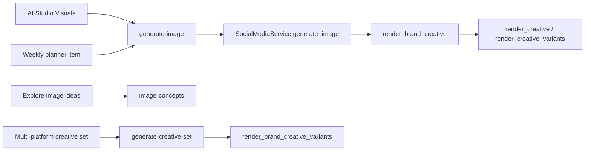
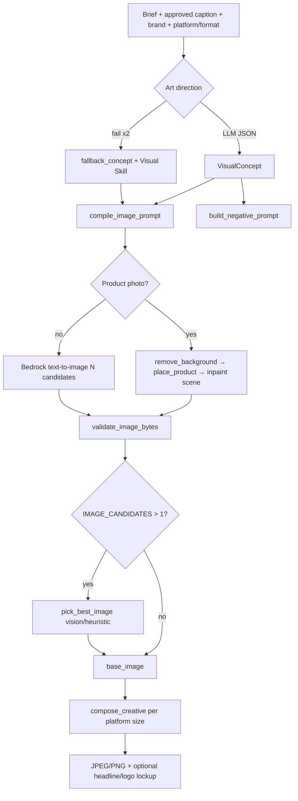

# EarnedVoice image generation — end-to-end reference

This document describes how **AI Studio**, the **weekly planner**, and the **social API** produce post images in `social-backend`. It covers models, skills, prompts, stages, and configuration.

**Source of truth (code):**

| Layer | Path |
|--------|------|
| Creative pipeline | `social-backend/app/social/ai/creative.py` |
| Visual skills | `social-backend/app/social/ai/visual_skills.py` |
| Bedrock image API | `social-backend/app/social/ai/image_generator.py`, `app/providers/llm/bedrock_image.py` |
| Model catalog | `app/providers/llm/model_selection.py` |
| Judge & quality | `app/social/ai/image_judge.py`, `image_quality.py` |
| Product photo path | `app/social/ai/product_scene.py` |
| Layout / logo overlay | `app/social/ai/compositor.py` |
| HTTP | `POST /api/v1/workspaces/{id}/social/generate-image`, `image-concepts`, `generate-creative-set` |

---

## 0. Source code map (simplified)

Read top-to-bottom in this order when debugging a bad image.

### 0.1 Call chain

```
router.generate_image (router.py)
  → SocialMediaService.generate_image (service.py)
       ├─ creative is None → image_generator.generate_post_image_from_url
       └─ creative set    → render_brand_creative → render_creative → render_creative_variants (creative.py)
```

### 0.2 HTTP entry — build `CreativeSpec`, then generate

```790:832:frontend/social-backend/app/social/router.py
@router.post("/generate-image", response_model=GenerateImageResponse)
def generate_image(...):
    creative = None
    if payload.format:
        creative = CreativeSpec(
            format=payload.format,
            platform=payload.platform.value if payload.platform else None,
            caption=payload.caption or "",
            concept_override=payload.concept.model_dump() if payload.concept else None,
            product_asset_id=payload.productAssetId or None,
            # ... headline, logo, text_overlay, slides, etc.
        )
    return SocialMediaService(db).generate_image(workspace, user, payload.topic, ...)
```

### 0.3 Service — full vs simple path

```1656:1690:frontend/social-backend/app/social/service.py
if creative is not None and mode == "create":
    result = self.render_brand_creative(workspace, topic, style, creative)
    upload = upload_social_image_bytes(...)
    record_ai_usage(..., "image", ...)
    return GenerateImageResponse(imageUrl=..., width=result.width, ...)

# else: legacy/simple Bedrock call only
data = generate_post_image_from_url(topic=topic, style=style, size=size, mode=mode, ...)
```

`render_brand_creative` loads brand voice + logo bytes, then calls `render_creative`:

```1880:1904:frontend/social-backend/app/social/service.py
def render_brand_creative(self, workspace, topic, style, spec):
    brand = self._brand_voice_dict(ws_id) if spec.use_brand else {}
    logo_bytes = ...  # from logo_id or brand logo_url
    return render_creative(
        topic=topic, style=style, spec=spec, brand=brand, logo_bytes=logo_bytes,
        **self._creative_context(ws_id, spec),  # recent_subjects, product_image
    )
```

### 0.4 Pipeline core — `render_creative_variants`

```882:960:frontend/social-backend/app/social/ai/creative.py
# 1) Concept
elif base_image is None:
    concept, copy = art_direct(...)  # or concept_override / fallback_concept

# 2) Prompts
prompt = compile_image_prompt(concept, spec, brand, style)
negative_prompt = build_negative_prompt(concept, style, topic)

# 3) Generate
if product_image is not None:
    cutout = product_cutout(product_image)
    base = render_product_scene(cutout, ..., prompt, negative_prompt)  # inpaint
else:
    base = generate_post_image(..., prompt_override=prompt, negative_prompt=negative_prompt)

# 4) Pick best if IMAGE_CANDIDATES > 1
candidates = _generate_candidates(make, candidate_count(spec))
base_image = pick_best_image(candidates, brief=...) if len(candidates) > 1 else candidates[0]

# 5) Export per platform
image = compose_creative(base_image, width, height, layout=fmt, copy=..., logo_bytes=...)
```

### 0.5 Visual skill selection

```264:297:frontend/social-backend/app/social/ai/visual_skills.py
def select_visual_skill(caption, topic="", industry="", post_format=""):
    if post_format.lower() == "quote":
        return INSPIRATION_QUOTE
    for text in (caption, topic):
        for skill in VISUAL_SKILLS:
            if skill.matches(text):
                matched = skill
                break
    # optional industry fallback; food + opening event → celebratory override
    return matched
```

Skills are declared at the top of the same file (`HIRING_TEAM`, `FOOD_DRINK`, `THOUGHT_LEADERSHIP`, …) in `VISUAL_SKILLS`.

### 0.6 Art direction → JSON concept (text LLM)

```576:600:frontend/social-backend/app/social/ai/creative.py
system_prompt = (
    "You are the art director ... Reply with JSON only: {schema}. "
    "The approved post caption is the primary visual source ..."
)
if skill:
    system_prompt += (
        f"Suggested visual strategy '{skill.name}': conceptType '{skill.concept_type}', "
        f"medium '{skill.medium}'. {skill.subject_guide} ..."
    )
# user: caption first, then topic, format WxH, brand lines, recent subjects
concept, copy = _concept_from_data(parsed_json, topic)
```

### 0.7 Compiled prompts sent to Stability

```428:448:frontend/social-backend/app/social/ai/creative.py
def compile_image_prompt(concept, spec, brand, style) -> str:
  parts = [subject, setting, medium, style, composition+frame, lighting, mood, palette, ...]
  return ". ".join(parts) + "."

def build_negative_prompt(concept, style, topic) -> str:
  parts = [_BASE_NEGATIVE, _PHOTO_NEGATIVE or _ILLUSTRATION_NEGATIVE, cliches, concept.avoid, ...]
  return ", ".join(parts)[:1200]
```

### 0.8 Bedrock image invoke

```42:49:frontend/social-backend/app/providers/llm/bedrock_image.py
def image_generation_configured() -> bool:
    model = current_models().image or settings.bedrock_image_model_id or DEFAULT_IMAGE_MODEL_ID
    return bool(valid model + AWS creds + not retired)
```

```184:197:frontend/social-backend/app/providers/llm/bedrock_image.py
def generate_text_to_image(*, prompt, size="1024x1024", negative_prompt=None) -> bytes:
    model_id = _resolved_image_model_id()
    body = _stability_text_to_image_body(prompt=..., width, height, negative_prompt=...)
    b64_images = _invoke_raw(body, model_id=model_id)
    return _decode_output(b64_images[0])
```

Default model:

```18:18:frontend/social-backend/app/providers/llm/bedrock_image.py
DEFAULT_IMAGE_MODEL_ID = "stability.stable-image-ultra-v1:1"
```

Catalog (workspace **Settings → AI models**):

```67:72:frontend/social-backend/app/providers/llm/model_selection.py
_IMAGE_MODELS = (
    CuratedModel("stability.stable-image-ultra-v1:1", "Stable Image Ultra", ...),
    CuratedModel("stability.sd3-5-large-v1:0", "Stable Diffusion 3.5 Large", ...),
    CuratedModel("stability.stable-image-core-v1:1", "Stable Image Core", ...),
)
```

### 0.9 Simple path prompt (no art direction)

```28:36:frontend/social-backend/app/social/ai/image_generator.py
def _build_create_prompt(topic, style):
    parts = [
        compact_context(topic, 600),
        f"Style: {style}" or "Medium: best fits subject",
        "Single clear focal subject, generic models ...",
        "No text, letters, numbers, logos or watermarks ...",
        "High detail, professional finish",
    ]
```

### 0.10 Product + inpaint

```21:57:frontend/social-backend/app/social/ai/product_scene.py
def product_cutout(image_bytes) -> Image:
    if not transparent: image = remove_background(...)  # Bedrock service
def render_product_scene(cutout, width, height, prompt, negative_prompt) -> bytes:
    canvas, product, position = place_product(cutout, width, height)
    scene = inpaint(canvas_png, prompt=..., negative_prompt=...)
    scene.alpha_composite(product, position)
```

### 0.11 Judge & quality

```84:103:frontend/social-backend/app/social/ai/image_judge.py
def pick_best_image(candidates, brief):
    scores = _vision_scores(candidates, brief)  # multimodal LLM JSON scores
    # else heuristic_score(contrast + edges)
    return index of max score
```

```30:38:frontend/social-backend/app/social/ai/image_quality.py
# reject IMAGE_NEAR_BLACK, IMAGE_UNIFORM, IMAGE_FULLY_TRANSPARENT after decode
```

### 0.12 Frontend (AI Studio)

| UI step | API / field |
|---------|----------------|
| Brief textarea | `topic` |
| Approved captions | `caption` on `CreativeSpec` |
| Image style optional | `style` + `artDirection` merged into request |
| Explore image ideas | `POST .../image-concepts` → user picks `concept` → `concept_override` |
| Product photo | `productAssetId` |
| Generate image button | `POST .../generate-image` with full `CreativeSpec` |

Implementation: `frontend/social-frontend/src/components/social-media/ai-studio/AIStudioPage.tsx` (`generateImage`, `exploreConcepts`).

---

## 1. Where images are triggered



### Full creative path (AI Studio with `CreativeSpec`)

Used when the request includes `format`, `platform`, `caption`, brand flags, optional `concept`, `productAssetId`, etc.

1. Enforce workspace **image allowance** (`enforce_ai_image_limit`).
2. Optional default **style** from workspace `social_settings.image_generation_style`.
3. `render_brand_creative` → `render_creative` / `render_creative_variants`.
4. Upload JPEG/PNG to workspace storage, record `social_media_assets`, **meter** `record_ai_usage(..., "image")`.

### Simple path (no `CreativeSpec`)

`generate_post_image` only: compact topic + optional style → Bedrock text-to-image (or image-to-image in **edit** mode). No art direction, skills, or compositor.

---

## 2. AWS Bedrock models

### Primary image generators (Stability AI on Bedrock)

| Model ID | Label | Notes |
|----------|--------|--------|
| `stability.stable-image-ultra-v1:1` | Stable Image Ultra | **Default** (`BEDROCK_IMAGE_MODEL_ID`) |
| `stability.sd3-5-large-v1:0` | Stable Diffusion 3.5 Large | Supports image-to-image |
| `stability.stable-image-core-v1:1` | Stable Image Core | **Text-to-image only** — cannot refine existing images (`IMAGE_MODEL_NO_VARIATION`) |

**Retired (must not use):** Nova Canvas, Titan Image Generator — `image_generation_configured()` returns false.

**Selection order:** Per-request header/model selection (`validate_model_selection`) → `settings.bedrock_image_model_id` → default Ultra.

**Region:** Stability models typically **`us-west-2`** (`BEDROCK_IMAGE_REGION` or auto from model id). Enable models under **Bedrock → Model access** in that region.

### Stability Image Services (product workflow)

| Model ID | Purpose |
|----------|---------|
| `us.stability.stable-image-remove-background-v1:0` | Cut product from photo |
| `us.stability.stable-image-inpaint-v1:0` | Paint scene around placed product |

Region: `BEDROCK_IMAGE_SERVICES_REGION` (default `us-west-2`).

### Vision / judge (text LLM with image input)

Used to **score multiple candidates** and (optionally) describe brand visual style:

- `BEDROCK_VISION_MODEL_ID` if set, else text model if it supports vision, else **Claude Haiku 4.5** candidate.

---

## 3. Configuration (`.env`)

```env
# Required for any AI images
BEDROCK_AWS_ACCESS_KEY_ID=...
BEDROCK_AWS_SECRET_ACCESS_KEY=...
BEDROCK_REGION=us-east-1                    # text / art direction LLM

BEDROCK_IMAGE_MODEL_ID=stability.stable-image-ultra-v1:1
BEDROCK_IMAGE_REGION=us-west-2
BEDROCK_IMAGE_QUALITY=premium               # passed through; Stability payload is aspect-ratio based
IMAGE_CANDIDATES=2                         # parallel generations (1–4); carousel forces 1
BEDROCK_VISION_MODEL_ID=                   # optional judge model
BEDROCK_IMAGE_SERVICES_REGION=us-west-2    # remove-background + inpaint
```

**Configured check:** `image_generation_configured()` — valid model + Bedrock credentials (not retired).

---

## 4. End-to-end pipeline (full creative)

Progress stages reported to the UI via `image_progress`: **`concept` → `generate` → `review` → `format`**.



### Inputs that matter (AI Studio → API)

| Input | Maps to |
|--------|---------|
| Brief / “What do you want to post?” | `topic` |
| Approved caption | `CreativeSpec.caption` (primary visual source after art direction) |
| Image style (optional) | `style` + brand `visual_style` |
| Post type / format | `CreativeSpec.format` (`post`, `banner`, `story`, `carousel`, `quote`, `product`) |
| Platform(s) | `platform` or multi-export in creative set |
| Explore concept selection | `concept_override` |
| Product photo | `productAssetId` → `product_image` bytes, `product_scene=True` |
| Logo toggle | `includeLogo`, `logoId`, `logo_position` |
| Text on image | `text_overlay`, `headline`, `subtext`, `cta`, `autoCopy` |

**Minimum prompt length in UI:** 5 characters (validation); art direction uses compacted caption + brief up to thousands of chars.

---

## 5. Visual skills (domain routing)

Before or during art direction, `select_visual_skill(caption, topic, industry, format)` matches regex triggers on copy and industry. The winning skill biases **concept type**, **medium**, **subject guide**, and **avoid** list.

| Skill | concept_type | Typical triggers |
|--------|----------------|------------------|
| `hiring_team` | people | hiring, join our team, meet the team |
| `customer_story` | people | case study, testimonial, client success |
| `event_invite` | event | webinar, conference, workshop, RSVP |
| `food_drink` | food | bakery, café, restaurant, menu, chef |
| `property_space` | place | real estate, villa, hotel, showroom |
| `care_wellness` | people | clinic, dental, salon, spa, wellness |
| `fitness_active` | people | gym, yoga, workout, marathon |
| `product_launch` | product | new feature, introducing, product launch |
| `offer_promo` | product | % off, sale, limited time, Diwali offer |
| `founder_story` | people | I built, my startup journey |
| `how_to_guide` | educational | how to, tips, checklist, best practices |
| `data_insight` | data | survey, % growth, benchmark (not % off) |
| `thought_leadership` | abstract | content strategy, B2B SaaS, founder brand |
| `inspiration_quote` | quote | quote of the day, Monday motivation |
| *(format=quote)* | quote | forced `INSPIRATION_QUOTE` |

**Special case:** `food_drink` + opening-day language → celebratory opening subject/medium override.

If no skill matches, `classify_concept()` uses keyword buckets (`food`, `event`, `place`, …) or **`abstract`**.

---

## 6. Art direction (text LLM)

**Function:** `art_direct(topic, spec, brand, style, …)` → `(VisualConcept, OverlayCopy)`.

- **System:** Senior art director; output **JSON only** with `conceptType`, `subject`, `setting`, `medium`, `composition`, `lighting`, `palette`, `mood`, `avoid[]` (+ optional headline/subtext/cta).
- **User message order:** Approved caption first (primary), then campaign brief, format dimensions, slide context, brand lines, palette phrase, **recent subjects** (variety), visual style.
- **Injected skill block:** strategy name, concept type, medium, subject guide, extra avoids.
- **Product scene:** forces `conceptType=product` and scene-around-product instructions.
- **Retries:** 2 attempts; on failure → `fallback_concept()` + user-visible warning `FALLBACK_WARNING`.

### Explore concepts (AI Studio “Explore image ideas”)

**Function:** `explore_concepts` → 3 JSON concepts (literal / metaphor / different medium) via same LLM pattern; fallback single concept from `fallback_concept`.

**API:** `POST .../image-concepts`

---

## 7. Prompt compilation (what Bedrock actually sees)

### Positive prompt — `compile_image_prompt(concept, spec, brand, style)`

Built from structured `VisualConcept`, joined with `. `:

1. **Subject** (≤360 chars)
2. Setting, medium (skill or `_MEDIUM` defaults)
3. User **style direction** + **series_style**
4. **Composition** + platform frame (`_frame(spec)` — aspect, safe area)
5. Lighting, **channel mood** (`_CHANNEL_MOOD[platform]`)
6. Palette (brand colours as accents for illustrations/quotes)
7. People/events: “Generic models, not identifiable real people”
8. **`_CLEAN_FINISH`:** plain surfaces, no in-image text/logos

### Negative prompt — `build_negative_prompt(concept, style, topic)`

Concatenated (≤1200 chars):

| Block | Content |
|--------|---------|
| `_BASE_NEGATIVE` | text, logos, watermarks, bad hands, blur, etc. |
| Photo vs illustration | `_PHOTO_NEGATIVE` or `_ILLUSTRATION_NEGATIVE` |
| `_CLICHES` | handshake, floating laptop/phone, robots, rockets, … unless brief asks |
| `concept.avoid` | skill + art-direction avoids |
| User style negations | parsed from “no …” phrases |

### Stability API body (`bedrock_image.generate_text_to_image`)

```json
{
  "prompt": "<compiled prompt, max 10k>",
  "mode": "text-to-image",
  "aspect_ratio": "<nearest of 1:1, 4:5, 5:4, 2:3, 3:2, 9:16, 16:9, …>",
  "output_format": "png",
  "negative_prompt": "<compiled negative>"
}
```

**Generation resolution:** `generation_size(target width/height)` scales toward ~1280px long edge, multiples of 16 (then compositor crops/fits to exact platform pixel size).

### Simple `generate_post_image` (no creative)

**Create:**

```
<compacted topic>. Style: <style or default medium>. Single focal subject, generic models.
No text/letters/logos. High detail, professional finish.
```

**Edit:** refinement prompt + downloaded `source_image_url` → `generate_image_variation` (requires Ultra or SD3.5, not Core).

---

## 8. Product photo path

1. User uploads/selects **product asset**.
2. `product_cutout`: optional `remove_background` if no alpha.
3. `place_product`: product ~62% width, lower-centre on transparent canvas.
4. `inpaint` scene from compiled prompt + negative prompt.
5. Composite original cutout back on top.
6. **No** separate text-to-image call for the product pixels.

---

## 9. Multi-candidate generation & judge

- `IMAGE_CANDIDATES` (default **2**): parallel `generate_post_image` calls with same prompt (ThreadPool).
- If more than one survivor: `pick_best_image(candidates, brief=caption + intended prompt)`.
  - **Vision judge:** Claude/Nova scores relevance, quality, cleanliness, penalizes `hasText`.
  - **Fallback:** luminance contrast + edge heuristic.
- Carousel: always **1** candidate per slide.

---

## 10. Quality gates — `validate_image_bytes`

After every base generation:

| Code | Meaning |
|------|---------|
| `IMAGE_FULLY_TRANSPARENT` | Empty alpha |
| `IMAGE_NEAR_BLACK` | Uniform black frame |
| `IMAGE_UNIFORM` | No visible detail |
| `IMAGE_DECODE_FAILED` | Invalid bytes |

Failures surface as **502** with `stage: "base"`.

---

## 11. Compositor — `compose_creative`

Takes validated **base_image** and produces final export per platform:

- Resize/crop to `target_size(format, platform)` (see table below).
- Optional **headline / subtext / CTA** overlay (`text_overlay`, quote format).
- Optional **logo** (corner) or **brand lockup** (name + tagline on campaign hero).
- Output: JPEG bytes for storage.

### Default export sizes (pixels)

| Format | Instagram | Facebook | LinkedIn | X |
|--------|-----------|----------|----------|---|
| post | 1080×1350 | 1080×1350 | 1200×1200 | 1600×900 |
| banner | — | 1200×630 | 1200×627 | 1600×900 |
| carousel | 1080×1350 | 1080×1350 | 1080×1080 | — |
| story | 1080×1920 (default) | | | |
| product | 1080×1350 | … | 1200×1200 | … |

---

## 12. API quick reference

### `POST .../social/generate-image`

| Field | Role |
|--------|------|
| `topic` | Brief |
| `style` | Optional art direction string |
| `size` | Simple path only (e.g. `1024x1024`) |
| `mode` | `create` \| `edit` |
| `sourceImageUrl` | Edit mode source |
| `format`, `platform`, `caption`, `headline`, … | Builds `CreativeSpec` |

### `POST .../social/image-concepts`

Returns up to 3 concepts for UI picker (`explore_concepts`).

### `POST .../social/generate-creative-set`

Multi-platform batch; status polling; uses `render_brand_creative_variants`.

### Workspace `GET .../social/ai-models`

Lists curated text + image models; workspace can override per request via model selection headers.

---

## 13. Error codes (client-facing)

| Code | Typical cause |
|------|----------------|
| `IMAGE_NOT_CONFIGURED` | Missing Bedrock creds or retired model |
| `IMAGE_MODEL_NO_VARIATION` | Core model + edit/variation |
| `IMAGE_PROVIDER_FILTERED` | Bedrock content filter |
| `IMAGE_PROVIDER_EMPTY` | No images in response |
| `IMAGE_PROVIDER_FAILED` | Invoke/region/IAM errors |
| `IMAGE_SERVICE_UNAVAILABLE` | Remove-background / inpaint unavailable |
| `PRODUCT_NOT_FOUND` | Could not isolate product |
| `IMAGE_COMPOSE_FAILED` | Overlay/layout failure |
| `IMAGE_NEAR_BLACK` / `IMAGE_UNIFORM` / … | Quality gate |

---

## 14. Testing a good EarnedVoice post (example)

**Brief (topic):** Product value for Indian SMBs + Free plan + soft CTA (no guaranteed leads).

**AI Studio selections:**

| Step | Choice |
|------|--------|
| Brief | Paste full brief |
| Post type | Promotional or Educational |
| Post to | LinkedIn (+ Instagram if image required) |
| Writing | Professional, Medium, hashtags on |
| Text | Generate → approve copy |
| Visuals | Generate image on; optional art direction textarea |
| Image style | e.g. workspace planner mood, no text in image |

**Backend flow:** `thought_leadership` or `how_to_guide` skill likely matches → art direction JSON → compiled prompt → Ultra @ aspect ratio → 2 candidates → judge → compose 1200×1200 (LinkedIn) → S3 URL.

---

## 15. Operational checklist

- [ ] `BEDROCK_IMAGE_MODEL_ID` enabled in **us-west-2** (or configured region)
- [ ] Stability Image Services enabled if using **product photo**
- [ ] Text model for art direction enabled in `BEDROCK_REGION`
- [ ] Optional: `BEDROCK_VISION_MODEL_ID` for better multi-candidate picking
- [ ] Workspace brand profile filled (industry, colours, visual style) for better prompts
- [ ] Monitor AI image usage against plan limits

---

*Last aligned with codebase: `social-backend` creative + Bedrock image modules + `AIStudioPage.tsx`. Update section **0** when call sites or function names change.*